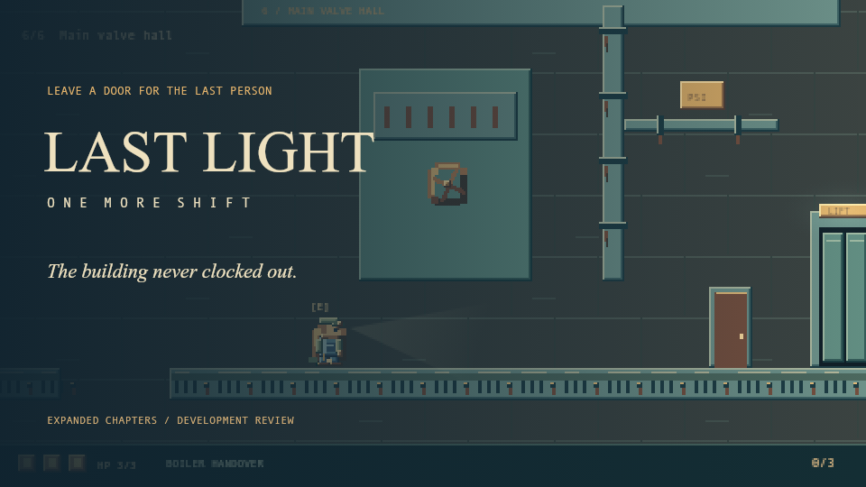

# LAST LIGHT · One More Shift
## 《最后一盏灯：再值一班》

## HTML5 release candidate · 3.0.0-rc.40

[RC40 changes and verification](docs/releases-rc40.md) · [RC39 verification and live audio](docs/closeout-rc39.md) · [RC39 close-contact horror](docs/contact-horror-rc39.md) · [RC38 roof loop and apparition performance](docs/roof-loop-rc38.md) · [RC37 Ash Front and touch layout](docs/ash-front-rc37.md) · [RC36 fitted Poly Haven models](docs/online-models-rc36.md) · [RC35 city streets and straight roof joins](docs/city-and-fascia-rc35.md) · [RC34 roof fascia corners](docs/roof-corners-rc34.md) · [RC33 boiler controls and archive wall fit](docs/wall-fit-rc33.md) · [RC32 carpet binding and roof return](docs/fit-rc32.md).

[RC31 electrical fittings, soffits and annex joints](docs/detail-rc31.md) · [RC30 utilities, roof fixtures and skyline](docs/utilities-rc30.md) · [RC29 junctions, landings and roof returns](docs/junctions-rc29.md) · [RC28 hazards and evidence props](docs/inspection-rc28.md) · [RC27 close-up architecture](docs/architecture-rc27.md) · [RC26 map geometry](docs/geometry-map-rc26.md) · [RC25 roof combat and English voice](docs/geometry-combat-rc25.md).

[移动游玩、设施建模与实录音效 / Touch play, plant models and field recordings](docs/mobile-and-production-rc21.md) · [档案室重制与抓捕动画 / Archive rebuild and capture sequence](docs/archive-and-capture-rc20.md)

[设置与女鬼 / Settings and the Mourning Clerk](docs/settings-and-mourning-rc19.md) · [后室追逐实测 / Records Annex playtest](docs/backrooms-rc17.md) · [Earlier gameplay verification](docs/gameplay-flow-rc15.md)

[Play on itch.io](https://tomhao.itch.io/last-light). The first-person edition rebuilds the boiler rooms, offices and rooftop as connected 3D spaces. Switch between 17:59 and 18:00 to cross phase-specific bridges, finish nine handover tasks and piece together why Gary's name never made it into the register. Use corners, lamps and quiet movement to get past roaming ghosts. Machinery can cost a point of integrity. Ghost contact or a fall begins a death sequence. The last lamp restores the shift.

```sh
npm ci
npm start
# Open http://127.0.0.1:8786/3d/
npm test
npm run check
python3 scripts/package-3d.py
```

- Right-click the game view or click the phase button to switch day and night. WASD moves, the mouse looks around, E interacts, Space jumps, Shift sprints, C walks quietly, J opens the journal, M mutes and Esc pauses. The first bridge exists at night. Starting or resuming captures the mouse. Esc pauses and releases it. On touch screens, drag the scene to look and tap the phase button to switch.
- On desktop, press Enter to resume from pause. Set mouse sensitivity from 50% to 200% in Settings. If the browser releases the mouse, click the scene to capture it again. The browser's Escape shortcut also releases a captured mouse when you bind Pause to a different key.
- WebGL 2 renders the game using a locally bundled copy of [Three.js](https://github.com/mrdoob/three.js/tree/r187). The game combines procedural sets with imported props and photographic PBR materials. The high preset adds depth-aware light shafts and contact shading. Balanced and Performance reduce rendering cost. Web Audio synthesizes the score and mixes recorded dialogue, spatial effects and room tone. Desktop High defaults to a fixed render resolution. Adaptive resolution can be enabled in Settings. The FPS display reports both frame rate and actual render size.
- Blender-authored models give the boiler worker, records clerk and roof caretaker their own faces, clothing and equipment. The janitor's hand operates the controls and wears a watch that advances one minute on a shift. Folding inspection gates retract their bolts before opening.
- All dialogue and spoken guidance use English recordings in both editions. 3D subtitles and both interfaces remain available in English and Chinese. [Cast, sources and licenses](dist/3d/assets/CREDITS.md).
- On the **3D roof only**, click the left mouse button, press **F** (rebindable), or tap **Strike**. Aim at a nearby visible apparition. A hit staggers it; one, two or three hits banish it depending on difficulty. Banishment lasts until checkpoint revival or reload. Earlier chapters and Classic are unchanged.
- The visual update adds floor-specific fittings, practical fixtures and signs, a refined phase effect, and individual face, workwear and movement details for each 3D pursuer.
- Select **Play in Mobile** on either title screen. In 3D, use the left joystick and drag the scene to look. Open **Layout** to drag or resize any of the seven round controls. Portrait and landscape save separately. In 2D, use the left and right buttons. Each edition has separate jump, phase and interact buttons that accept simultaneous touches. Menu, status, subtitles and touch controls adapt to short landscape screens. During dialogue, the score and room tone duck while nearby threats stay audible. If a pause interrupts a line, it restarts when play resumes.
- The title menu offers **Play 3D** and **Play 2D**. From the expanded pixel edition, select **Play 3D** on the title card to return. Each edition has its own save. With `npm start`, the 2D edition is also at the server root. The current trailer shows both editions.

### Settings in both editions

Open **Settings → Key bindings** from the title or pause screen. Select a slot and press a key or right-click to bind the mouse button. Right-click switches phase by default in both editions. Classic also accepts either Shift key. You can assign X in either edition. Each action can have up to three keys, and you can swap an occupied key or restore the defaults. The guide, interaction prompts and phase shortcut show your current bindings. Each edition saves its own keys in the browser. Touch controls keep their dedicated buttons.

Choose **Story**, **Standard** or **Nightmare** in **Settings → Difficulty**. Story gives you more time to escape an enemy and recover from hazards. Nightmare shortens the reaction window and makes enemies faster. You can change difficulty during a run. Each edition remembers the choice separately from the checkpoint save.

### The Mourning Clerk

The offices are haunted by the Mourning Clerk. When you look directly at her in the active phase, she rushes toward you. Break eye contact to stop her charge, and give her room as you pass. The meter tracks her aggression, and contact is lethal. In 3D, look down or turn away. In 2D, turn away, hold the quiet-walk key (**C** by default) to lower your eyes, or jump clear of her sightline. Walls and doors can also break her line of sight. Use the phonograph near the office lift to replay the recorded warning, or read the note in the journal.

### The Records Annex

A transfer slip sends the janitor into a stretch of lit corridors between the archives and the next safe room. A worker follows through both phases. In **2D**, hold Right or D, jump the carts and gaps with Space, and switch in the air with right-click or Shift. The emergency lamp halfway through records your progress. Players with a finished save can enter the annex from Chapters. In **3D**, hold W facing the fire door, steer around tall shelving with A/D, jump the barriers with Space and right-click when a phase bridge is missing. The transfer floor gives forward movement full running speed. The cry behind you changes direction as you turn your head.

The expanded route runs through several distinct interiors. In 2D, the boiler annex and mail-handling rooms add changes in floor height, transfer carts, unlit bridges and tighter jump sequences. In 3D, the tiled return-air room and high microfilm stacks lead to an amber-lit concrete stairwell. Alternating passages through the shelving, deeper shafts and six phase bridges keep the runner moving. The new score gains pace through the run, while the worker's steps and cries track the distance behind you.

The steam trap downstairs, outgoing slip case in the offices, roof drainage hopper and modular annex are original [Blender assemblies](art/blender/backrooms-annex.blend). The 3D game loads their meshes. The pixel edition uses orthographic Cycles renders of the same props. [Desktop gameplay captures](media/backrooms-rc16.jpg).

### Character art sources

Open the [three workers](art/blender/late-workers.blend), [janitor hand](art/characters/janitor.blend) and [folding service lift](art/blender/service-lift.blend) in Blender 4.5 LTS. The [pressure gallery and roof services](art/blender/pressure-and-roof.blend) add caged lamps, rainwater tanks and fans. Pressure drops in the boiler gauge, office doors settle on springs and water runs from the rooftop nozzles when each station is operated. [Gameplay screenshots](media/character-art-rc14.jpg) · [Release checks](docs/character-review-rc14.json).

### Advanced maintenance routes

- **2D** has an upper route in each of the 18 sections. Hold Space, switch with **right-click** or **Shift** while airborne, and land before launching again. The upper route rejoins the room beyond the first gap and has an emergency lamp. You can also reach every work station from the lower walkways.
- **3D** has a sprint-jump shortcut on each floor. Save at the lamp beside the entrance, hold **Shift** to sprint, jump with **Space**, and right-click before landing on the next pad. On the roof, turn between jumps. The standard corridors still lead to the lift.

The Chrome runners exercise the real game with keyboard input. The 2D relay run deliberately misses the first catch in each section, retries, verifies the lamp save, and then clears the section. The 3D shortcut runner checks every jump and lamp revival. Its journey mode starts a fresh game and follows the standard corridors.

[Read the browser receipt for all 21 sections and floors.](docs/route-playtest-rc12.json)

```sh
EVIDENCE_DIR=/tmp/last-light-2d-relays CHECK_RELAYS=1 CHECK_RELAY_RECOVERY=1 ENDING=complete npm run test:playthrough
EVIDENCE_DIR=/tmp/last-light-2d-normal npm run test:playthrough
node scripts/browser-3d-shortcuts.mjs
JOURNEY=complete node scripts/browser-3d-shortcuts.mjs
```

## Expanded 2D edition

The browser release retains the `2.0.0-rc.1` expanded world and its save format. It adds separate painted backdrops for all 18 sections, material wear, more detailed actor sprites and door motion, and a faster-reading phase effect. The archived 2D ZIP is still available below.

Eli is a living adult returning to finish a handover. Day is 17:59 before the fire; night is what remained at 18:00. Twelve years ago Gary returned to release the fire doors, but the register incorrectly said he had already evacuated. The task is to acknowledge the person the record omitted—not to kill an evil Gary.



## Play locally

```sh
npm ci
npm start
```

Open **http://127.0.0.1:8786/**. Any static server can serve `dist/`. No runtime libraries, accounts, remote assets or network services are needed. Native resolution remains **480×270**, with unchanged **14×28** player collision and normal camera scale.

**Existing saves:** pre-expansion saves are backed up and continue on their original compatible maps. To enter the expanded game from an old save, choose **Restart shift** at the bottom of the page; the existing save is backed up first. Fresh saves enter the expansion automatically. Do not clear local storage to migrate.

- A/D or arrows: move; hold C for quiet walking.
- Space / W / up: jump; release early for a short jump.
- Right-click / Shift: switch memories. E / down: work, clues, doors, exit light.
- J: journal. M: mute. Esc: pause/resume. Touch controls remain available.
- Settings offer the same difficulty and key binding controls, plus master/music/SFX volume and reduced flash effects.
- Scenes advance automatically. E can advance a beat after its minimum animation time; the departure has a longer minimum so its actors can finish leaving.

## Expanded chapters

Each chapter now contains **six separately authored sections**, connected by collision-aware, staged doors:

- **Boiler:** duty rooms, loading passage, steam hall, cooling shaft, return inspection bridge, main valve hall.
- **Office:** lift lobby, work maze, archive mezzanine, pantry, fire corridor, Gary’s office.
- **Roof:** machine room, water tower, greenhouse, exterior inspection route, antenna bridges, exit beacon.

Each section spans 1920×1620 at the original scale, with horizontal galleries, explicitly placed stairwells, observation balconies, split-phase crossings, solid machinery, warned timed hazards, named lamps and powered return routes. Work persists through death and chapter return. Camera movement is genuinely two-axis; bounds alone are not counted as exploration.

The reproducible space audit uses the **actual archived local 4200/4550/4900 baseline**, never the old 1450-wide ZIP. It unions phase duplicates, excludes empty bounds and moving-platform sweep, subtracts machine-occupied standing intervals, and counts only physics-graph-reached surfaces. Qualifying occupied-screen ratios are **16.0× / 16.0× / 14.4×**; standing-interval ratios are **19.99× / 19.56× / 18.97×**. Definitions, conservative baseline denominator and limitations: `docs/LEVEL_DESIGN.md`, `docs/evidence/expanded/space-summary.json`. Numeric density is not a substitute for subjective route/art quality review.

## Story, animation and sound

- Eighteen work mechanisms and bilingual sequences: pressure release, restored machinery, corrected register, ringing phone, Gary holding the fire release while people escape, lunchbox sliding through the gap, water/plant changes, and a five-second-warned final pursuit.
- Normal and complete endings have staged departure animations. The complete ending requires all six evidence records, the corrected register and the independently powered exit lamp. Harmless memory figures are separate from lethal enemy collision.
- Three HP; ordinary immunity; ghost/abyss instant death; idempotent dying and separate safe lamp reassembly. Inactive phase platforms draw no pixels or hints and have no collision.
- Chapter/section material families, distinct memory actors, readable warning states, continuity across scene beats, and visible abyss death at deep camera positions.
- 120.32-second synth arrangement cycle, section variation, phase/chapter timbres, narrative ducking, pursuit and resolution layers, spatial alerts and separate mix controls. The actual 136-second review render has zero clipped/non-finite samples. **It has not been subjectively listened to.**

## Verification

Both **fresh-game → normal ending** and **fresh-game → complete ending** passed through real Chrome mouse/keyboard input, with **zero deaths in each run**. These were not coordinate/save-injected runs. A genuine completed browser profile was then reopened, revisited, switched to Chinese, journal-checked and reloaded successfully. Input/action logs, runtime hashes and real scene/ending screenshots are preserved in `docs/evidence/expanded/`.

**52 tests pass**, covering retained-map compatibility and expanded-world behaviour. See `docs/TEST_REPORT.md` and `docs/PLAYTHROUGH.md` for exact evidence and earlier failures.

```sh
npm test
npm run check
npm run test:space                 # conservative physics-component space audit
npm run test:browser               # smoke/layout, not whole-game proof
npm run test:playthrough           # bounded expanded normal-ending input run
ENDING=complete npm run test:playthrough
npm run test:revisit               # uses the preceding completed test profile
node scripts/verify-evidence.mjs   # rejects stale checked-in RC evidence
node scripts/render-audio.mjs      # numeric synth review, not a listening test
node scripts/render-media.mjs      # explicitly controlled composition previews
npm run package                   # local RC archives only; never publishes
```

Chrome defaults to the macOS installation; override `CHROME`. Playtests stop at three deaths, a stalled-goal bound or their overall deadline. Test browsers now close gracefully so the harness does not damage its own profile storage.

## Packages and remaining review

`releases/last-light-2.0.0-rc.1-html5.zip` contains the actual playable root `index.html`. The matching source ZIP includes runtime, source, tests, documentation and evidence. Runtime members are byte-compared; exact hashes are in `releases/SHA256.json` and its versioned copy.

Still unverified: subjective headphone/speaker listening, physical touch devices, full Firefox/Safari runs, full-map target-device performance and external final art/design sign-off. Desktop/headless smoke and numeric audio checks are not those reviews. This is a release candidate, not a fabricated all-platform sign-off.

The [jam entry](https://itch.io/jam/game-off-2026/rate/5327077) and the existing `LAST_LIGHT_trailer.mp4` document the original edition.

## Credits and disclosure

Created with AI assistance for code, procedural pixel art, synthesized music and sound effects, writing and testing. The 3D edition includes licensed artwork, recorded effects and performed English dialogue. The original 2D edition uses code-authored art and sound. Characters and events are fictional. Original source and content use MIT. Third-party assets and dependencies retain their licenses. Author and entrant: Tomhao10225101490.
